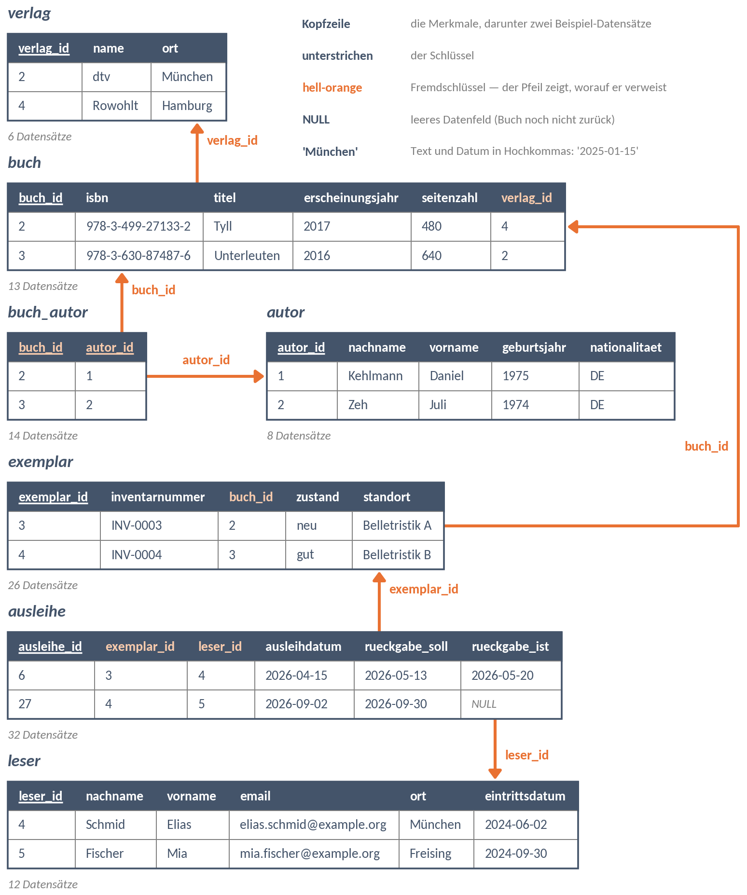

# Skript · Stunde 06 · SQL I: Fragen an eine Tabelle

**Datenbanken · Fachschule für Künstliche Intelligenz · 22.10.2026**

## Die Datenbank

Laden Sie die fertige Datenbank `bibliothek.db` aus dem Klassenrepository herunter: Ordner `00_Beispieldatenbank` → `bibliothek.db` anklicken → Download-Symbol rechts oben. Oder direkt: <https://github.com/sschaffenroth/2627_KI1_DB/raw/main/00_Beispieldatenbank/bibliothek.db>

Dann im DB Browser for SQLite: **Datenbank öffnen** (nicht *Neue Datenbank*) → `bibliothek.db` aus Ihrem Download-Ordner wählen.

{width=16cm}

## So arbeiten Sie

1. Datenbank öffnen mit DB-Browser for sqlite.
2. Den Befehl ausprobieren.
3. Den Befehl notieren.

---

## Stufe 1 — Merkmale auswählen: SELECT und FROM

> `SELECT` nennt die **Merkmale**, die Sie sehen wollen, durch Komma getrennt. `FROM` nennt die **Tabelle**. Ein `*` statt der Merkmale heißt: alle Merkmale. Jede Abfrage endet mit einem **Semikolon**.
>
> **Beispiel:**
>
> ```sql
> SELECT nachname, vorname
> FROM   autor;
> ```
>
> 8 Datensätze, alle Autorinnen und Autoren.

**Notieren Sie die Befehle:**

**1.1** Alle Merkmale aller Verlage.

**1.2** Titel und Seitenzahl aller Bücher.

**1.3** Ort, Nachname und Vorname aller Leserinnen und Leser.

---

## Stufe 2 — Sortieren: ORDER BY

> `ORDER BY` sortiert das Ergebnis — aufsteigend (`ASC`, das ist der Standard) oder absteigend mit `DESC` **hinter** dem Merkmal. Mehrere Sortiermerkmale mit Komma: erst nach dem ersten, bei Gleichstand nach dem zweiten. `ORDER BY` steht **nach** `FROM`.
>
> **Beispiel:**
>
> ```sql
> SELECT   nachname, geburtsjahr
> FROM     autor
> ORDER BY geburtsjahr;
> ```
>
> Oben steht Lutz (1961), unten Kleppmann (1985).

**Notieren Sie die Befehle:**

**2.1** Titel und Seitenzahl aller Bücher, das dickste zuerst.

**2.2** Nachname und Vorname aller Leserinnen und Leser, alphabetisch nach Nachname.

**2.3** Ort, Nachname und Vorname aller Leserinnen und Leser — sortiert nach Ort, im selben Ort nach Nachname.

---

## Stufe 3 — Datensätze auswählen: WHERE

> `WHERE` wählt die **Datensätze** aus: Nur wer die Bedingung erfüllt, kommt ins Ergebnis. Vergleichen mit `=`, `<>` (ungleich), `<`, `>`, `<=`, `>=`. **Text und Datum in einfache Hochkommas**: `'DE'`, `'2025-01-01'`. Zahlen ohne. `WHERE` steht nach `FROM` und **vor** `ORDER BY`.
>
> **Beispiel:**
>
> ```sql
> SELECT nachname, vorname
> FROM   autor
> WHERE  nationalitaet = 'DE';
> ```
>
> 5 Datensätze. `SELECT` wählt Merkmale, `WHERE` wählt Datensätze.

**Notieren Sie die Befehle:**

**3.1** Vorname und Nachname aller Leserinnen und Leser aus Freising.

**3.2** Titel und Erscheinungsjahr aller Bücher, die ab 2019 erschienen sind, das älteste zuerst.

**3.3** Inventarnummer und Standort aller Exemplare im Zustand `defekt`.

**3.4** Titel aller Bücher, die **nicht** beim Verlag 5 erschienen sind.

---

## Stufe 4 — Mehrere Bedingungen: AND und OR

> `AND`: **beide** Bedingungen müssen stimmen. `OR`: **mindestens eine**. Kommen beide vor, wird `AND` zuerst ausgewertet — wie Punkt vor Strich. Im Zweifel klammern: `(a OR b) AND c`.
>
> **Beispiel:**
>
> ```sql
> SELECT nachname, geburtsjahr
> FROM   autor
> WHERE  nationalitaet = 'DE' AND geburtsjahr > 1975;
> ```
>
> 2 Datensätze: Stanisic und Weidner.

**Notieren Sie die Befehle:**

**4.1** Titel, Erscheinungsjahr und Seitenzahl aller Bücher, die ab 2015 erschienen sind **und** weniger als 400 Seiten haben.

**4.2** Vorname, Nachname und Ort aller Leserinnen und Leser aus Dachau **oder** Freising.

**4.3** Vorname, Nachname und Eintrittsdatum aller Leserinnen und Leser, die **im Jahr 2025** eingetreten sind.

**4.4** Vorname, Nachname, Ort und Eintrittsdatum aller Leserinnen und Leser aus Dachau **oder** Freising, die **ab 2025** eingetreten sind. Setzen Sie die Klammer.

---

## Stufe 5 — Vier kleine Werkzeuge

> - `IS NULL` findet **leere** Datenfelder. Mit `= NULL` findet man nie etwas.
> - `LIKE 'W%'` findet Text, der mit W **beginnt**. Das `%` steht für „beliebig viel danach“.
> - `SELECT DISTINCT` zeigt gleiche Ergebnisse nur **einmal**.
> - `LIMIT 3` zeigt nur die **ersten drei** — sinnvoll nur nach `ORDER BY`.

**Notieren Sie die Befehle:**

**5.1** Vorname und Nachname aller Leserinnen und Leser **ohne** E-Mail-Adresse. Probieren Sie zuerst `WHERE email = NULL` — was passiert? Dann mit `IS NULL`.

**5.2** Nachname und Vorname aller Leserinnen und Leser, deren Nachname mit **W** beginnt.

**5.3** Alle Standorte der Exemplare, **jeder nur einmal**, alphabetisch.

**5.4** Titel und Seitenzahl der **drei** dicksten Bücher.

---

## Das ganze Gerüst

Die Reihenfolge ist fest:

```
SELECT   merkmale
FROM     tabelle
WHERE    bedingung
ORDER BY merkmal
LIMIT    anzahl;
```

---

## Stufe 6 — Wie in der Schulaufgabe: erst Papier, dann Rechner

**6.1** Gemeint waren die Bücher der Verlage 2 oder 3, die mehr als 400 Seiten haben. Schreiben Sie **zuerst** auf, was diese Abfrage liefert. Dann ausführen.

```sql
SELECT   titel
FROM     buch
WHERE    verlag_id = 2 OR verlag_id = 3 AND seitenzahl > 400
ORDER BY titel;
```

Warum steht „Herkunft“ im Ergebnis? Wie lautet die richtige Abfrage?

**6.2** Gesucht: Titel und Seitenzahl aller Bücher, deren Titel mit „D“ beginnt — das dickste zuerst. Die Abfrage enthält **vier** Fehler. Schreiben Sie sie richtig auf, dann prüfen.

```sql
SELECT   titel, seitenzahl
FROM     buecher
ORDER BY DESC seitenzahl
WHERE    titel LIKE D%;
```

---

## Für Schnelle — LIKE genauer


> `LIKE` vergleicht Text mit einem **Muster**. `%` steht für beliebig viele Zeichen — auch für keins. `_` steht für **genau ein** Zeichen. Wo das `%` steht, entscheidet: `'W%'` am Anfang, `'%er'` am Ende, `'%Python%'` irgendwo. `NOT LIKE` dreht die Bedingung um.
>
> **Beispiel:**
>
> ```sql
> SELECT nachname, vorname
> FROM   autor
> WHERE  nachname LIKE '%mann';
> ```
>
> 2 Datensätze: Kehlmann und Kleppmann.

**Notieren Sie die Befehle:**

**Z1** Titel aller Bücher, in deren Titel „Python“ **irgendwo** vorkommt.

**Z2** Nachname und Vorname aller Leserinnen und Leser, deren Nachname auf **„er“ endet**, alphabetisch.

**Z3** Nachname und Vorname aller Leserinnen und Leser, deren Nachname **genau vier** Buchstaben hat.

**Z4** Nummer und Ausleihdatum aller Ausleihen **im August 2026** — diesmal mit `LIKE` statt mit `>=` und `<=`.

**Z5** Alle Buchtitel, die aus **einem einzigen Wort** bestehen.

**Z6** Knobelaufgabe: Vorname, Nachname und Ort aller Leserinnen und Leser aus München **oder** Dachau, deren Nachname auf „er“ endet, alphabetisch.

**Noch ein Baustein aus der Schulaufgabe:** Texte aneinanderhängen.

**Z7** Alle Leserinnen und Leser aus München als **eine** Spalte mit der Überschrift `name`, zum Beispiel „Anna Bauer“. *Tipp:* `vorname || ' ' || nachname AS name`.

---

## Hausaufgabe

**Gestellt:** Do 22.10.2026 · **Fällig:** Do 29.10.2026, zu Stundenbeginn

**1 — Übungen.** Dieselben Bausteine wie heute, an anderen Tabellen der Bibliothek. Arbeiten Sie wie in der Stunde: ausprobieren, dann notieren. Was Sie heute im Skript nicht geschafft haben, holen Sie vorher nach.

### Stufe 1 — SELECT und FROM

**H1.1** Alle Merkmale aller Autorinnen und Autoren.

**H1.2** Inventarnummer und Standort aller Exemplare.

### Stufe 2 — ORDER BY

**H2.1** Nachname, Vorname und Geburtsjahr aller Autorinnen und Autoren, die jüngste Person zuerst.

**H2.2** Titel und Erscheinungsjahr aller Bücher, das neueste zuerst.

### Stufe 3 — WHERE

**H3.1** Name und Ort aller Verlage aus München.

**H3.2** Nachname und Geburtsjahr aller Autorinnen und Autoren, die vor 1975 geboren sind.

**H3.3** Inventarnummer und Zustand aller Exemplare im Standort `Magazin`.

### Stufe 4 — AND und OR

**H4.1** Name und Ort aller Verlage aus Berlin **oder** Hamburg.

**H4.2** Inventarnummer aller Exemplare im Magazin, die im Zustand `gut` sind.

**H4.3** Titel und Seitenzahl aller Bücher von Verlag 4 **oder** Verlag 5 mit **weniger** als 500 Seiten. Klammer!

### Stufe 5 — IS NULL, LIKE, DISTINCT, LIMIT

**H5.1** Nummer und Ausleihdatum aller Ausleihen, die **noch nicht zurückgegeben** sind (`rueckgabe_ist` ist leer).

**H5.2** Nachname und Vorname aller Autorinnen und Autoren, deren Nachname mit **K** beginnt.

**H5.3** Alle Zustände der Exemplare, **jeder nur einmal**.

**H5.4** Titel und Seitenzahl der **zwei** dünnsten Bücher.

### Gemischt

**H6.1** Vorname und Nachname aller Leserinnen und Leser aus München **ohne** E-Mail-Adresse.

**H6.2** Alle Orte, aus denen Leserinnen und Leser kommen, **jeder nur einmal**, alphabetisch.

**H6.3** Nummer, Ausleihdatum und Rückgabe-Soll aller Ausleihen, die **noch nicht zurückgegeben** sind — die früheste Soll-Rückgabe zuerst.

**H6.4** Titel und Seitenzahl aller Bücher von Verlag 2 **oder** Verlag 3 mit **weniger** als 400 Seiten, das dünnste zuerst. Klammer!

**2 — Von Hand, ohne Rechner.** Schreiben Sie diese Abfrage **zuerst auf Papier** und bringen Sie das Blatt mit: *Titel und Seitenzahl aller Bücher von Verlag 2 mit mehr als 400 Seiten — das dickste zuerst.* Prüfen Sie sie danach am Rechner und notieren Sie, was Sie korrigieren mussten.

**3 — Spickblatt.** In der Schulaufgabe am 12.11. ist ein eigenes, handgeschriebenes Spickblatt DIN A4 erlaubt (Vorder- und Rückseite, mit Namen; es wird abgegeben). Heute passt darauf: das Gerüst und die Bausteine der Stufen 1 bis 5. Am 29.10. schreiben Sie die Probe-Schulaufgabe schon mit Ihrem Spickblatt.
