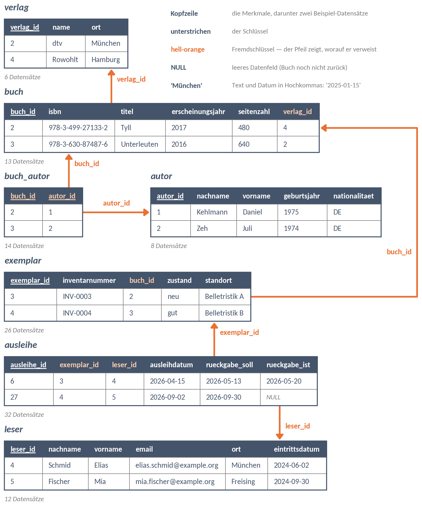
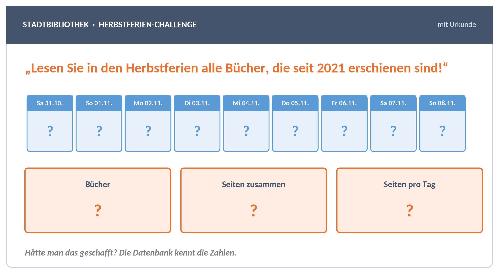
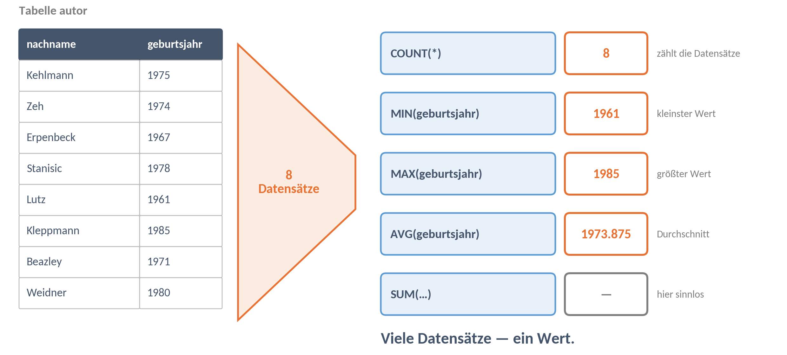

# Skript · Stunde 07 · SQL II: Zahlen aus der Datenbank

**Datenbanken · Fachschule für Künstliche Intelligenz · 12.11.2026 · Selbstlernkurs**

Sie arbeiten heute **allein**, ohne Lehrkraft. Gehen Sie den Fahrplan von oben nach unten durch. Schreiben Sie jeden Befehl in die Übungsdatei `05_Uebungen.sql` (Klassenrepository, Ordner dieser Stunde) unter die passende Nummer. Nach jeder Aufgabe steht ein **Kontrollwert**: Kommt bei Ihnen etwas anderes heraus, suchen Sie den Fehler, bevor Sie weitergehen.

## Ihr Fahrplan für heute (90 Minuten)

| Schritt | Was | Zeit | Erledigt |
|---|---|---|---|
| 0 | Ankommen: `bibliothek.db` öffnen, Ihre Abfrage von Hand aus der Hausaufgabe mit den fünf Prüffragen prüfen | 10 min | ☐ |
| 1 | Das Problem lesen: die Herbstferien-Challenge — und eine Vermutung notieren | 5 min | ☐ |
| 2 | Stufen 1 bis 4: ausprobieren, notieren, mit dem Kontrollwert vergleichen | 35 min | ☐ |
| 3 | Das Problem lösen — erst ohne Skript versuchen | 15 min | ☐ |
| 4 | Für Schnelle | 15 min | ☐ |
| 5 | Abgeben: die Übungsdatei in Teams ablegen | 5 min | ☐ |


**Kein Stoff der Schulaufgabe am 26.11.** — aber Sie brauchen es im Projekt und in der 2. Schulaufgabe.

---

## Die Datenbank

Sie arbeiten wieder mit `bibliothek.db` (Klassenrepository, Ordner `00_Beispieldatenbank`). Im DB Browser for SQLite: **Datenbank öffnen**.

<details><summary><b>Bild der Datenbank: die sieben Tabellen der Stadtbibliothek</b> — zum Aufklappen hier klicken</summary>



</details>

---

## Schritt 0 — Ankommen: Ihre Abfrage von Hand

Die Aufgabe aus der Hausaufgabe: Titel und Seitenzahl aller Bücher von Verlag 2 mit mehr als 400 Seiten — das dickste zuerst. Prüfen Sie Ihre Abfrage mit den fünf Prüffragen und korrigieren Sie in anderer Farbe.

1. Reihenfolge: `SELECT` → `FROM` → `WHERE` → `ORDER BY` → `LIMIT`
2. Text und Datum in Hochkommas: 'Dachau', '2025-01-01' — Zahlen ohne
3. Spalten- und Tabellennamen genau so wie in der Datenbank
4. „Kein Wert“ mit IS NULL, nie mit = NULL
5. AND und OR gemischt? Dann Klammern


Dann tippen Sie Ihre Abfrage in den DB Browser. **Kontrolle:** 3 Datensätze — Unterleuten (640 Seiten), Zwischen Welten (448 Seiten), Über Menschen (416 Seiten).

---

## Schritt 1 — Das Problem: die Herbstferien-Challenge

Vor den Herbstferien hat die Stadtbibliothek zur **Herbstferien-Challenge** aufgerufen: „Lesen Sie in den Herbstferien alle Bücher, die seit 2021 erschienen sind!“ Wer es schafft, bekommt eine Urkunde. Jetzt wertet die Bibliothek aus: Hätte man das überhaupt schaffen können?



**Wie viele Bücher waren es, wie viele Seiten hatten sie zusammen — und wie viele Seiten hätten Sie an jedem der neun freien Tage vom 31.10. bis 08.11. lesen müssen?**

Bisher kann die Datenbank Datensätze nur **anzeigen**. Heute lernen Sie, wie sie selbst **zählt und rechnet**. Notieren Sie zuerst eine Vermutung: Hätten Sie es geschafft?

**Die Idee in einem Bild:** Eine Aggregatfunktion macht aus vielen Datensätzen **einen** Wert.



---

## Schritt 2 · Stufe 1 — Zählen: COUNT(*)

> Eine **Aggregatfunktion** fasst viele Datensätze zu **einem** Wert zusammen. `COUNT(*)` zählt die Datensätze. Mit `WHERE` wählen Sie vorher aus, **welche** gezählt werden. Mit `AS` geben Sie der Ergebnisspalte einen Namen.
>
> **Beispiel:**
>
> ```sql
> SELECT COUNT(*) AS anzahl
> FROM   autor
> WHERE  nationalitaet = 'DE';
> ```
>
> Ergebnis: eine Spalte `anzahl`, ein Datensatz, Wert 5 — so viele Autorinnen und Autoren kommen aus Deutschland.

**Notieren Sie die Befehle:**

**1.1** Wie viele Exemplare besitzt die Bibliothek? — **Kontrolle:** 26

**1.2** Wie viele Leserinnen und Leser wohnen in München? — **Kontrolle:** 7

---

## Schritt 2 · Stufe 2 — Summe und Durchschnitt: SUM und AVG

> `SUM(merkmal)` addiert die Werte eines Merkmals, `AVG(merkmal)` bildet ihren Durchschnitt. Beide rechnen nur mit **Zahlen**.
>
> **Beispiel:**
>
> ```sql
> SELECT AVG(geburtsjahr) AS mittel
> FROM   autor;
> ```
>
> Ergebnis: 1973.875 — ein Durchschnitt ist selten eine glatte Zahl.

**Notieren Sie die Befehle:**

**2.1** Wie viele Seiten haben alle Bücher zusammen? — **Kontrolle:** 6992

**2.2** Wie viele Seiten hat ein Buch von Verlag 5 im Durchschnitt? — **Kontrolle:** 990.0

---

## Schritt 2 · Stufe 3 — Kleinster und größter Wert: MIN und MAX

> `MIN(merkmal)` liefert den kleinsten, `MAX(merkmal)` den größten Wert. Das klappt auch mit Text (alphabetisch) und mit einem Datum. Mehrere Funktionen stehen mit Komma nebeneinander.
>
> **Beispiel:**
>
> ```sql
> SELECT MIN(geburtsjahr) AS aelteste,
>        MAX(geburtsjahr) AS juengste
> FROM   autor;
> ```
>
> Ergebnis: 1961 und 1985.

**Notieren Sie die Befehle:**

**3.1** In welchem Jahr ist das älteste Buch erschienen, in welchem das neueste? In **einer** Abfrage. — **Kontrolle:** 2005 · 2023

**3.2** An welchem Tag war die erste Ausleihe? *Das Datum steht als Text `JJJJ-MM-TT` — deshalb ist das kleinste auch das früheste.* — **Kontrolle:** 2026-03-02

---

## Schritt 2 · Stufe 4 — Was COUNT(merkmal) zählt

> `COUNT(*)` zählt **Datensätze**. `COUNT(merkmal)` zählt nur die Datensätze, in denen das Merkmal einen **Wert** hat — leere Datenfelder (`NULL`) übergeht es.
>
> **Beispiel:**
>
> ```sql
> SELECT COUNT(*)             AS ausleihen,
>        COUNT(rueckgabe_ist) AS zurueck
> FROM   ausleihe;
> ```
>
> Ergebnis: 32 und 24 — bei den übrigen ist noch keine Rückgabe eingetragen.

**Notieren Sie die Befehle:**

**4.1** Wie viele Leserinnen und Leser wohnen in München — und wie viele davon haben eine E-Mail-Adresse? In **einer** Abfrage. — **Kontrolle:** 7 · 6

**4.2** Wie viele Ausleihen sind noch **nicht** zurückgegeben? Rechnen Sie mit dem Beispiel nach — oder finden Sie eine Abfrage, die die Zahl direkt liefert. *Nachgerechnet: Ausleihen minus zurückgegebene. Direkt: `WHERE rueckgabe_ist IS NULL`.* — **Kontrolle:** 8

---

## Das Gerüst

```
SELECT   FUNKTION(merkmal) AS name
FROM     tabelle
WHERE    bedingung;
```

Erst wählt `WHERE` die Datensätze aus, dann rechnet die Funktion — nur mit denen, die übrig sind.

---

## Schritt 3 — Das Problem lösen

Versuchen Sie es **erst ohne Skript**. Nur wenn Sie nicht weiterkommen: Blättern Sie zurück zu den Stufen.

**P1** Wie viele Bücher sind seit 2021 erschienen?

**P2** Wie viele Seiten haben sie zusammen?

**P3** Wie viele Seiten hätten Sie an jedem der 9 Tage lesen müssen? *Tipp:* Teilen Sie durch `9.0`, nicht durch `9`.

**Notieren Sie die Befehle und Ihre Antwort in einem Satz: Hätten Sie es geschafft?**

<details><summary><b>Kontrolle zur Challenge</b> — erst aufklappen, wenn Sie fertig sind</summary>

P1: 5 · P2: 1880 · P3: 208.89 (mit `/ 9` statt `/ 9.0`: 208). Für Schnelle: Alles geht in **einer** Abfrage — mehrere Funktionen mit Komma nebeneinander.

</details>

---

## Prüfen Sie sich selbst


- **Warum steht in jeder Abfrage dieselbe WHERE-Bedingung?**

- **Warum COUNT für die Bücher und SUM für die Seiten?**

- **Warum / 9.0 und nicht / 9?**

- **Geht alles in einer Abfrage?**


<details><summary><b>Antworten</b> — erst aufklappen, wenn Sie selbst eine Antwort haben</summary>


- *Warum steht in jeder Abfrage dieselbe WHERE-Bedingung?* Es zählen nur die Bücher seit 2021. Ohne WHERE wären es 13 Bücher und 777 Seiten pro Tag.

- *Warum COUNT für die Bücher und SUM für die Seiten?* COUNT zählt Datensätze (Bücher), SUM addiert die Werte eines Merkmals (Seiten).

- *Warum / 9.0 und nicht / 9?* Zwei ganze Zahlen geteilt ergeben in SQLite eine ganze Zahl: 208 statt 208.88888888888889.

- *Geht alles in einer Abfrage?* Ja — mehrere Funktionen mit Komma nebeneinander, eine WHERE-Bedingung für alle.


</details>

**Das merken wir uns** (ins Heft):


- Eine Aggregatfunktion macht aus vielen Datensätzen einen Wert.

- Erst wählt WHERE aus, dann rechnet die Funktion.

- COUNT zählt Datensätze, SUM addiert Werte.

- Mit Ergebnissen rechnen: SUM(seitenzahl) / 9.0 — mit .0, sonst ganze Zahl.


---

## Schritt 4 — Für Schnelle


**D1** Die durchschnittliche Seitenzahl aller Bücher — auf **eine** Nachkommastelle gerundet. *Tipp:* `ROUND(AVG(seitenzahl), 1)`. — **Kontrolle:** 537.8

**D2** Aus wie vielen **verschiedenen** Orten kommen die Leserinnen und Leser? *Tipp:* `COUNT(DISTINCT ort)`. — **Kontrolle:** 4

**D3** Wie viele Ausleihen wurden **zu spät** zurückgegeben — `rueckgabe_ist` liegt nach `rueckgabe_soll`? — **Kontrolle:** 4

**D4** Wie viele Bücher sind **dicker als der Durchschnitt**? Erst den Durchschnitt bestimmen, dann zählen. — **Kontrolle:** 4

**D5** Ausblick: Wie viele Exemplare gibt es **je Zustand**? `GROUP BY` bildet für jeden Zustand eine eigene Gruppe: `SELECT zustand, COUNT(*) FROM exemplar GROUP BY zustand;` Probieren Sie es aus — und zählen Sie dann die Leserinnen und Leser **je Ort**. — **Kontrolle:** 4 Datensätze, oben München · 7

**D6** Mit zwei Funktionen rechnen: Wie viele Seiten liegen zwischen dem dünnsten und dem dicksten Buch? In **einer** Abfrage. *Tipp:* `MAX(seitenzahl) - MIN(seitenzahl)`. — **Kontrolle:** 1360

**D7** Knobelaufgabe: Wie viel **Prozent** der Leserinnen und Leser haben eine E-Mail-Adresse? Schreiben Sie `100.0`, nicht `100` — warum? — **Kontrolle:** 91.66666666666667


---

## Schritt 5 — Abgeben

Speichern Sie Ihre Übungsdatei als `SQL_II_Nachname.sql` (Ihr Nachname statt „Nachname“) und legen Sie sie in Teams im Team der Klasse unter **Dateien → `Abgabe_2026-11-12_SQL_II`** ab. Schreiben Sie Ihre Antwort zur Challenge als Kommentar (`-- Antwort: …`) in die Datei. Was Sie nicht geschafft haben, bleibt einfach leer.

---

## Hausaufgabe

**Gestellt:** Do 12.11.2026 · **Fällig:** Do 03.12.2026, zu Stundenbeginn

Notieren Sie zu jeder Aufgabe den Befehl und das Ergebnis. Probieren Sie jeden Befehl in `bibliothek.db` aus.

**H1** Wie viele Bücher sind bei Verlag 2 erschienen?

**H2** Wie viele Seiten haben die Bücher von Verlag 3 zusammen?

**H3** In welchem Jahr ist die älteste Person unter den deutschen Autorinnen und Autoren geboren?

**H4** An welchem Tag ist zuletzt jemand in die Bibliothek eingetreten?

**H5** Wie viele Exemplare sind **nicht** im Zustand `gut`?

**H6** Wie viele Leserinnen und Leser haben **keine** E-Mail-Adresse? Finden Sie zwei Wege.
