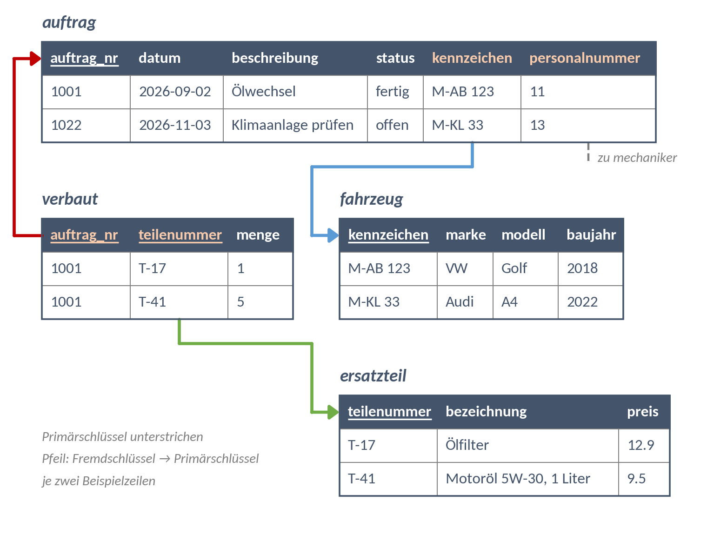

<!-- leistungsnachweis titel="Probe-Schulaufgabe Datenbanken, Teil B (am Rechner)" punkte="30" -->
# Probe-Schulaufgabe · Datenbanken · Teil B (am Rechner)

**Dauer** 30 Minuten · **Hilfsmittel** DB Browser for SQLite, eigene Unterlagen · **kein Internet, keine KI**

Auf Ihrem USB-Stick liegt die Datenbank der Werkstatt, `Werkstatt.db`. Legen Sie alle Befehle in der Datei **`DB_Vorname_Nachname.sql`** auf dem USB-Stick ab.

---

## Die Tabellen

<!-- seitenumbruch -->

## Aufgabe B1 — Abfragen (20 Punkte)

*Notieren Sie zu a) bis f) jeweils den entsprechenden SQL-Befehl.*

a) *Geben Sie Nummer, Datum und Beschreibung aller **offenen** Aufträge aus; der älteste Auftrag steht oben.* (4 P)

b) *Geben Sie Nummer und Beschreibung aller Aufträge aus, deren Beschreibung mit **„Brems"** beginnt.* (3 P)

c) *Geben Sie Bezeichnung und Preis der **drei teuersten** Ersatzteile aus.* (3 P)

d) *Geben Sie Kennzeichen, Marke und Modell aller Fahrzeuge aus, bei denen **kein Baujahr eingetragen** ist.* (3 P)

e) *Geben Sie alle **Marken** aus, die in der Tabelle `fahrzeug` vorkommen — **jede Marke nur einmal**, alphabetisch sortiert.* (3 P)

f) *Geben Sie Nummer, Datum und Beschreibung aller Aufträge aus, die der Mechaniker mit der **Personalnummer 12 im Oktober 2026** bearbeitet hat.* (4 P)

## Aufgabe B2 — Zählen und Rechnen (10 Punkte)

*Notieren Sie zu a) bis d) jeweils den entsprechenden SQL-Befehl.*

a) *Ermitteln Sie die Anzahl der **offenen** Aufträge.* (2 P)

b) *Ermitteln Sie in einer Abfrage die Anzahl aller Fahrzeuge und die Anzahl der Fahrzeuge, bei denen ein **Baujahr eingetragen** ist.* (3 P)

c) *Ermitteln Sie, wie viele Liter **Motoröl (Teilenummer T-41)** insgesamt verbaut wurden.* (2 P)

d) *Ermitteln Sie den **durchschnittlichen** und den **höchsten** Preis aller Ersatzteile. Geben Sie beiden Spalten mit `AS` eine aussagekräftige Überschrift.* (3 P)
